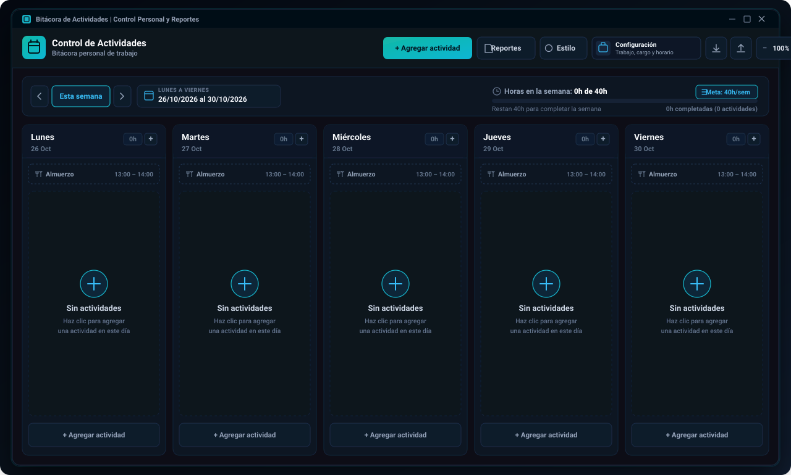

# Bitácora de Actividades (Activity Tracker Desktop)

[](https://github.com/aledash3/activity-tracker-desktop/actions)
[](https://v2.tauri.app/)
[](https://www.rust-lang.org/)
[](https://react.dev/)
[](https://vite.dev/)
[](https://github.com/aledash3/activity-tracker-desktop/releases)
[](https://github.com/aledash3/activity-tracker-desktop/releases)
[](LICENSE)
[](README.md)

Aplicación nativa ultraligera de escritorio construida con **React 19, Vite, Rust y Tauri v2** para el registro de actividades laborales y de investigación con semana laboral configurable, horarios dinámicos de almuerzo por día, control de metas de horas semanales, personalización de colores y caligrafía, y generación de reportes ejecutivos en PDF y CSV (Excel).

> **Idioma / Language:** Español | [Read documentation in English](README.md)

---

## Vista Previa de la Interfaz

<p align="center">
  
</p>

---

## Descripción General

**Bitácora de Actividades** está diseñada para investigadores, docentes, personal técnico y equipos de proyectos que requieren llevar un control estructurado de sus actividades diarias y horas semanales directamente en su escritorio, generando reportes firmables sin depender de servidores locales ni empaquetar navegadores pesados. Gracias a **Tauri v2** y **WebView2** nativo de Windows, el instalador pesa menos de **5 MB**.

---

## Características Principales

- **Tablero Semanal Configurable:** Elige qué días trabajas (cualquier combinación de lunes a domingo). El tablero muestra una columna a pantalla completa por cada día laborable, con botones de creación rápida, cambio de estado (`Completado` / `Pendiente`) y selector mensual con los días no laborables deshabilitados.
- **Horarios de Almuerzo Dinámicos por Día:** Define uno o más horarios de almuerzo y asigna cada uno a un grupo de días (por ejemplo, de lunes a miércoles de `13:00` a `14:00` y jueves a viernes de `12:00` a `12:30`). El bloque de almuerzo aparece automáticamente en cada día correspondiente del calendario sin tener que registrarlo a mano, y su duración se descuenta de las actividades que lo cruzan (de `08:00` a `17:00` con una hora de almuerzo registra `8h`).
- **Solicitante de Actividades:** Cada actividad permite registrar quién la solicita (`solicitante`), con sugerencias automáticas tomadas de registros anteriores y del supervisor configurado. El solicitante se incluye en las tarjetas del tablero, en la vista previa de reportes, en el PDF y en el archivo CSV.
- **Meta de Horas Semanales:** Configuración rápida de horas objetivo por semana (`meta_horas_semanales`) desde la barra de progreso o desde el perfil laboral.
- **Estudio de Apariencia y Caligrafía:**
  - Modo Claro y Modo Oscuro.
  - 6 paletas de color predefinidas más selector de color HEX personalizado que también aplica al encabezado y tablas de los reportes PDF.
  - 7 fuentes tipográficas y caligráficas (`Plus Jakarta Sans`, `Inter`, `Lora`, `Playfair Display`, `Caveat`, `Dancing Script` y `JetBrains Mono`).
  - Ajuste de tamaño de texto (`Compacto`, `Normal`, `Grande`) y estilo de esquinas (`Recto`, `Suave`, `Redondeado`).
- **Exportación de Reportes y Respaldos:**
  - **Reportes en PDF (`jsPDF` + `jspdf-autotable`):** Incluye membrete institucional, ficha de datos del responsable, tabla detallada de actividades con columna de solicitante, resumen de horas y bloque doble de firmas (responsable y supervisor/coordinador).
  - **Exportación CSV (Excel):** Archivo tabular con codificación UTF-8 BOM listo para abrir en Microsoft Excel.
  - **Respaldo en JSON:** Exportación e importación completa de configuración, categorías, estilo y actividades en un clic.

---

## Estructura del Proyecto

```text
activity-tracker-desktop/
├── .github/
│   ├── ISSUE_TEMPLATE/
│   │   ├── bug_report.md          # Plantilla para reporte de errores
│   │   └── feature_request.md     # Plantilla para solicitud de mejoras
│   └── workflows/
│       └── desktop-release.yml    # Pipeline CI/CD con Tauri v2 y Rust para Windows
├── build/
│   ├── icon.ico                   # Ícono multirresolución para Windows
│   └── icon.png                   # Ícono de aplicación en alta resolución
├── docs/
│   └── assets/
│       └── app_preview.svg        # Vista previa vectorial de la interfaz
├── public/
│   └── icon.png                   # Ícono estático de la aplicación
├── scripts/
│   └── generate-icons.ps1         # Script generador de íconos
├── src/
│   ├── components/
│   │   ├── ActivityCard.jsx       # Tarjeta individual de actividad
│   │   ├── ActivityModal.jsx      # Formulario modal de creación y edición
│   │   ├── AppearanceModal.jsx    # Estudio de colores, tema y caligrafía
│   │   ├── CatalogModal.jsx       # Administrador de categorías personalizadas
│   │   ├── DayPicker.jsx          # Selector de días de la semana
│   │   ├── MiniCalendar.jsx       # Calendario mensual (solo días laborables habilitados)
│   │   ├── Navbar.jsx             # Barra superior de navegación y acciones rápidas
│   │   ├── ProfileModal.jsx       # Configuración laboral, cargo, días laborables y almuerzos
│   │   ├── ReportsModal.jsx       # Filtro de reportes, métricas y exportación PDF/CSV
│   │   ├── WeekNavigator.jsx      # Selector semanal y barra de progreso de horas
│   │   └── WeeklyGrid.jsx         # Columnas dinámicas por día laborable y bloques de almuerzo
│   ├── utils/
│   │   ├── csvExport.js           # Exportador de archivos CSV para Excel
│   │   ├── dateUtils.js           # Cálculo de fechas y horas por solapamiento
│   │   ├── jornada.js             # Días laborables, reglas de almuerzo y migración de ajustes
│   │   ├── pdfExport.js           # Generador de informes PDF con bloque de firmas
│   │   └── storage.js             # Persistencia local, paletas y respaldos JSON
│   ├── App.jsx                    # Componente raíz e inyección de variables CSS
│   ├── index.css                  # Sistema de diseño, cuadrícula responsiva e impresión
│   └── main.jsx                   # Punto de entrada de React 19
├── src-tauri/
│   ├── capabilities/
│   │   └── default.json           # Permisos y capacidades de seguridad de Tauri v2
│   ├── icons/                     # Íconos nativos multirresolución
│   ├── src/
│   │   ├── lib.rs                 # Inicializador del contenedor Tauri v2
│   │   └── main.rs                # Punto de entrada nativo del subsistema Windows
│   ├── build.rs                   # Script de compilación Cargo
│   ├── Cargo.toml                 # Manifiesto de Rust y perfil de optimización LTO
│   └── tauri.conf.json            # Configuración de ventana, WebView2 e instalador NSIS
├── CHANGELOG.md                   # Historial de versiones
├── CONTRIBUTING.md                # Guía de contribución y Conventional Commits
├── LICENSE                        # Licencia MIT
├── README.es.md                   # Documentación en Español
├── README.md                      # Documentación en Inglés
├── index.html                     # Plantilla HTML base
├── package.json                   # Dependencias y scripts de Tauri CLI
└── vite.config.js                 # Configuración de Vite con rutas relativas
```

---

## Stack Tecnológico

| Capa | Tecnología | Versión | Propósito |
| :--- | :--- | :--- | :--- |
| **Contenedor Nativo** | Tauri v2 + Rust | `2.12.4` | Ventana nativa en Windows (WebView2) con bajo consumo de RAM |
| **Empaquetador** | Tauri NSIS Bundler | `2.12.4` | Generación de instalador `.exe` ultraligero y binario portable |
| **Interfaz de Usuario** | React | `19.3.1` | Arquitectura de componentes y estado reactivo |
| **Bundler Web** | Vite | `8.3.5` | Servidor de desarrollo con HMR y empaquetado optimizado |
| **Motor de Reportes** | jsPDF & AutoTable | `4.2.1` / `5.0.9` | Generación de documentos PDF vectoriales en cliente |
| **Iconografía** | Lucide React | `1.64.0` | Íconos vectoriales ligeros |
| **Análisis Estático** | Oxlint | `1.90.0` | Verificación rápida de código JavaScript/JSX |

---

## Instalación para Usuarios Finales (Windows)

Los usuarios finales pueden instalar y abrir la aplicación directamente en Windows 10/11 sin necesidad de instalar Node.js, Rust ni herramientas de programación:

1. Ingresa a la sección [Releases](https://github.com/aledash3/activity-tracker-desktop/releases) del repositorio.
2. Descarga cualquiera de las dos ediciones de la versión `v1.1.0`:
   - **`Bitacora-de-Actividades-Setup-1.1.0.exe` (Recomendado):** Ejecuta el asistente de instalación NSIS (~3-5 MB), crea accesos directos en el Escritorio y Menú Inicio, e incluye desinstalador.
   - **`Bitacora-de-Actividades-Portable-1.1.0.exe` (Portable):** Ejecutable nativo autónomo que abre directamente con doble clic sin requerir instalación.

---

## Desarrollo y Compilación desde el Código Fuente

### Requisitos Previos

- [Node.js](https://nodejs.org/) v20 o superior
- [Toolchain de Rust](https://rustup.rs/) (`rustup`, `cargo`, `rustc`)

### 1. Clonar el Repositorio

```bash
git clone https://github.com/aledash3/activity-tracker-desktop.git
cd activity-tracker-desktop
```

### 2. Instalar Dependencias

```bash
npm install
```

### 3. Comandos Disponibles

| Comando | Descripción |
| :--- | :--- |
| `npm run dev` | Inicia el servidor de desarrollo Vite en `http://127.0.0.1:5173` |
| `npm run desktop:dev` | Compila y abre la ventana nativa de escritorio con Tauri v2 y HMR |
| `npm run build` | Compila los archivos estáticos de producción en `dist/` |
| `npm run lint` | Ejecuta el analizador estático `oxlint` |
| `npm run build:exe` | Compila el ejecutable nativo en Rust y el instalador NSIS `.exe` |

---

## Autor

**David Alejandro Cruz Palacios**  
Estudiante de Ingeniería en Ciencias de la Computación - Universidad Politécnica Salesiana  
GitHub: [@aledash3](https://github.com/aledash3)

---

## Licencia

Este proyecto se distribuye bajo los términos de la [Licencia MIT](LICENSE).
