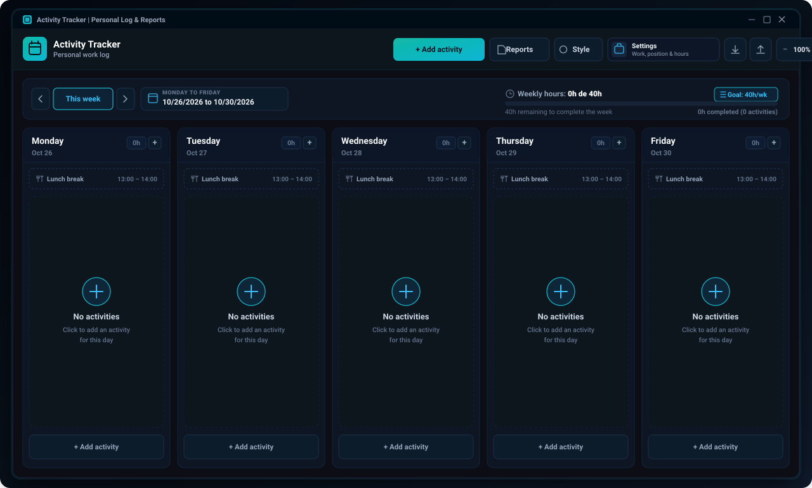

# Activity Tracker Desktop (Bitácora de Actividades)

[](https://github.com/aledash3/activity-tracker-desktop/actions)
[](https://v2.tauri.app/)
[](https://www.rust-lang.org/)
[](https://react.dev/)
[](https://vite.dev/)
[](https://github.com/aledash3/activity-tracker-desktop/releases)
[](https://github.com/aledash3/activity-tracker-desktop/releases)
[](LICENSE)
[](README.es.md)

Native lightweight desktop application built with **React 19, Vite, Rust, and Tauri v2** for tracking work and research activities on a configurable workweek, managing dynamic lunch schedules and weekly hour quotas, customizing typography and visual themes, and generating signed PDF and CSV reports.

> **Language / Idioma:** English | [Leer documentación en Español](README.es.md)

---

## Interface Preview

<p align="center">
  
</p>
<p align="center">
  <sub>🌐 <b>Preview Language:</b> <b>English</b> · <a href="docs/assets/app_preview_es.svg">Ver vista previa en Español (Spanish)</a></sub>
</p>

---

## Overview

**Activity Tracker Desktop** is built for researchers, university staff, and engineering teams who need a dedicated, low-memory desktop logbook to record daily tasks, monitor weekly hour quotas, and export institutional reports without running local web servers or bundling heavy browser runtimes. Powered by **Tauri v2** and Windows **WebView2**, the installer weighs under **5 MB**.

---

## Architectural & Functional Highlights

- **Configurable Workweek Board:** Choose which weekdays you work (any combination of Monday to Sunday). The board renders one full-height column per working day, with quick-add controls, status toggles (`Completed` / `Pending`), and a monthly calendar popover that disables non-working dates.
- **Per-Day Dynamic Lunch Schedules:** Define one or more lunch windows and assign each to a group of days (for example Monday to Wednesday `13:00` to `14:00`, and Thursday to Friday `12:00` to `12:30`). The lunch block appears automatically in every matching day of the calendar so you never log it manually, and its duration is automatically subtracted from any activity that crosses it (`08:00` to `17:00` with a 60-minute lunch records `8h`).
- **Requester Tracking:** Each activity records who requested it (`solicitante`), with autocomplete suggestions drawn from previous entries and the configured supervisor. The requester appears on board cards, report tables, PDF documents, and CSV exports.
- **Weekly Quota Progress:** Inline and profile-level configuration for required weekly hours (`meta_horas_semanales`) with real-time completion metrics.
- **Visual & Calligraphy Studio:**
  - Light and Dark themes.
  - 6 curated accent palettes plus a native HEX color picker that dynamically styles both the interface and generated PDF headers.
  - 7 typography and calligraphy options (`Plus Jakarta Sans`, `Inter`, `Lora`, `Playfair Display`, `Caveat`, `Dancing Script`, and `JetBrains Mono`).
  - Adjustable font scaling (`Compact`, `Normal`, `Large`) and border radius presets (`Sharp`, `Smooth`, `Rounded`).
- **Executive PDF & CSV Reporting:**
  - **PDF Reports (`jsPDF` + `jspdf-autotable`):** Generates institutional headers, user profile metadata, itemized activity tables with requester column, effective hour summaries, and dual signature blocks (responsible person and supervisor/coordinator).
  - **CSV Export:** Produces UTF-8 BOM semicolon-delimited files ready for Microsoft Excel.
  - **JSON Backups:** Single-click full state export and import (`perfil`, `categorias`, `apariencia`, and `actividades`).

---

## Project Structure

```text
activity-tracker-desktop/
├── .github/
│   ├── ISSUE_TEMPLATE/
│   │   ├── bug_report.md          # Standardized bug report template
│   │   └── feature_request.md     # Standardized feature request template
│   └── workflows/
│       └── desktop-release.yml    # Automated Tauri v2 Windows build & release pipeline
├── build/
│   ├── icon.ico                   # Multi-resolution Windows icon asset
│   └── icon.png                   # High-resolution source icon
├── docs/
│   └── assets/
│       ├── app_preview_en.svg     # English vector UI preview
│       ├── app_preview_es.svg     # Spanish vector UI preview
│       └── app_preview.svg        # Default UI preview
├── public/
│   └── icon.png                   # Application favicon asset
├── scripts/
│   └── generate-icons.ps1         # Automated icon asset generator
├── src/
│   ├── components/
│   │   ├── ActivityCard.jsx       # Individual activity item card
│   │   ├── ActivityModal.jsx      # Create/edit activity dialog with validation
│   │   ├── AppearanceModal.jsx    # Theme, accent color & calligraphy studio
│   │   ├── DayPicker.jsx          # Weekday toggle chips
│   │   ├── ExportModal.jsx        # Data export dialog (.xlsx, .pdf, .csv, .json)
│   │   ├── MiniCalendar.jsx       # Monthly date picker (working days enabled)
│   │   ├── Navbar.jsx             # Top navigation bar, zoom & quick actions
│   │   ├── ProfileModal.jsx       # Workplace, role, working days & lunch schedules
│   │   ├── ReportsModal.jsx       # Report filtering, KPI summary & PDF/CSV export
│   │   ├── WeekNavigator.jsx      # Week selector & weekly hour progress bar
│   │   └── WeeklyGrid.jsx         # Dynamic columns per working day & lunch blocks
│   ├── utils/
│   │   ├── csvExport.js           # Excel-compatible CSV generator
│   │   ├── dateUtils.js           # Date arithmetic & overlap-based hour math
│   │   ├── jornada.js             # Working days, lunch rules & legacy migration
│   │   ├── pdfExport.js           # Institutional PDF report builder
│   │   └── storage.js             # Local persistence, palettes & JSON backup I/O
│   ├── App.jsx                    # Root state orchestration & CSS variable injection
│   ├── index.css                  # Design tokens, responsive grid & print styles
│   └── main.jsx                   # React 19 DOM entry point
├── src-tauri/
│   ├── capabilities/
│   │   └── default.json           # Tauri v2 security capabilities & permissions
│   ├── icons/                     # Multi-resolution native application icons
│   ├── src/
│   │   ├── lib.rs                 # Tauri v2 application builder entry
│   │   └── main.rs                # Native Windows subsystem binary entry
│   ├── build.rs                   # Tauri Cargo build script
│   ├── Cargo.toml                 # Rust crate manifest & release LTO profile
│   └── tauri.conf.json            # Window dimensions, WebView2 & NSIS bundle config
├── CHANGELOG.md                   # Version history
├── CONTRIBUTING.md                # Contribution & Conventional Commits guide
├── LICENSE                        # MIT License
├── README.es.md                   # Spanish documentation
├── README.md                      # English documentation
├── index.html                     # Application HTML shell
├── package.json                   # Frontend dependencies & Tauri CLI scripts
└── vite.config.js                 # Vite bundler configuration
```

---

## Tech Stack

| Layer | Technology | Version | Purpose |
| :--- | :--- | :--- | :--- |
| **Desktop Runtime** | Tauri v2 + Rust | `2.12.4` | Native OS windowing, WebView2 rendering, low memory footprint |
| **Installer Bundler** | Tauri NSIS Bundler | `2.12.4` | Lightweight Windows `.exe` setup wizard and standalone binary |
| **Frontend Library** | React | `19.3.1` | Component architecture and reactive state management |
| **Build Tool** | Vite | `8.3.5` | Fast HMR development and optimized production bundling |
| **Report Engine** | jsPDF & AutoTable | `4.2.1` / `5.0.9` | Client-side vector PDF generation with dynamic styling |
| **Icons** | Lucide React | `1.64.0` | Consistent vector iconography |
| **Static Analysis** | Oxlint | `1.90.0` | High-speed JavaScript/JSX linting |

---

## End-User Installation (Windows)

End users can run the application directly on Windows 10/11 without installing Node.js, Rust, or any development tools:

1. Go to the [Releases](https://github.com/aledash3/activity-tracker-desktop/releases) page.
2. Download one of the available executables from the latest release (`v1.1.0`):
   - **`Bitacora-de-Actividades-Setup-1.1.0.exe` (Recommended):** Lightweight NSIS installer (~3-5 MB) that sets up the application, creates Desktop and Start Menu shortcuts, and registers a standard Windows uninstaller.
   - **`Bitacora-de-Actividades-Portable-1.1.0.exe` (Portable):** Standalone native executable that opens immediately without installation or administrator privileges.

---

## Development & Building from Source

### Prerequisites

- [Node.js](https://nodejs.org/) v20 or higher
- [Rust Toolchain](https://rustup.rs/) (`rustup`, `cargo`, `rustc`)

### 1. Clone the Repository

```bash
git clone https://github.com/aledash3/activity-tracker-desktop.git
cd activity-tracker-desktop
```

### 2. Install Dependencies

```bash
npm install
```

### 3. Available Scripts

| Command | Description |
| :--- | :--- |
| `npm run dev` | Start Vite web development server on `http://127.0.0.1:5173` |
| `npm run desktop:dev` | Compile and launch native Tauri v2 desktop window with HMR |
| `npm run build` | Compile production web assets into `dist/` |
| `npm run lint` | Run static code analysis with `oxlint` |
| `npm run build:exe` | Build optimized Rust release binary and Windows NSIS installer |

---

## Author

**David Alejandro Cruz Palacios**  
Computer Science Engineering Student - Universidad Politécnica Salesiana  
GitHub: [@aledash3](https://github.com/aledash3)

---

## License

This project is licensed under the terms of the [MIT License](LICENSE).
